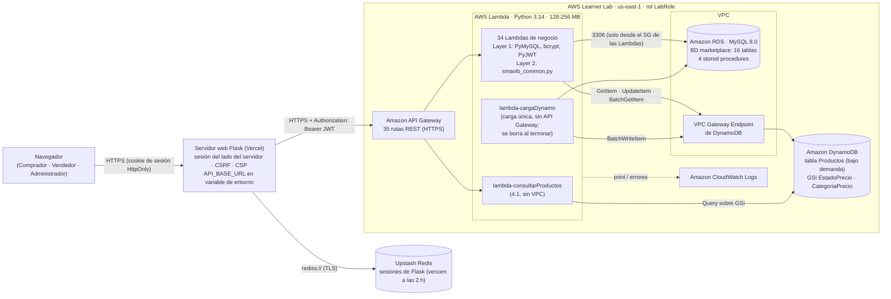
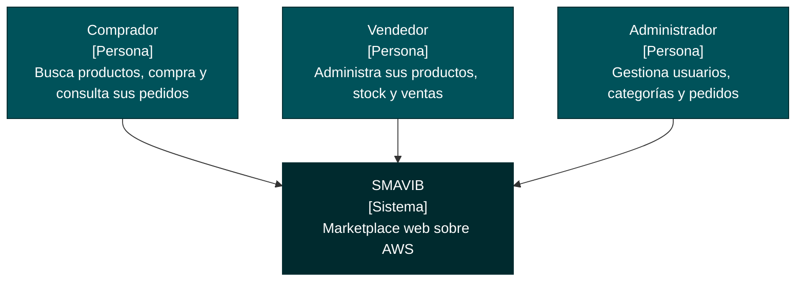
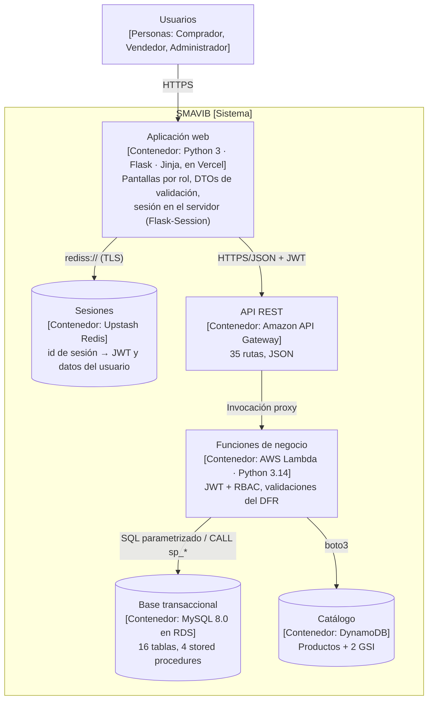

# Arquitectura de SMAVIB

Marketplace sobre **AWS Academy Learner Lab** (región `us-east-1`). Flujo único:

**Navegador → Flask → Amazon API Gateway → AWS Lambda → Amazon RDS (MySQL) y Amazon DynamoDB**

GitHub muestra los diagramas de este archivo como imágenes (Mermaid).

## 1. Diagrama de arquitectura AWS

| Componente | Decisión | Motivo |
|---|---|---|
| API Gateway | Una ruta por requerimiento del DFR (35); sin authorizer | Cada Lambda valida el JWT y el rol con `smavib_common.validar_token` |
| Lambda | Una función por requerimiento; conexión MySQL creada fuera del handler y reutilizada; reconexión si se cae | Menos conexiones a RDS y menor latencia en invocaciones calientes |
| Red | Las Lambdas que usan RDS van en la VPC. El grupo de seguridad de RDS acepta el puerto 3306 solo desde el de las Lambdas. DynamoDB se alcanza por el VPC Gateway Endpoint | Sin NAT Gateway ni RDS Proxy (costo en el Learner Lab) |
| Secretos | `DB_HOST`, `DB_USER`, `DB_PASSWORD`, `DB_NAME`, `JWT_SECRET` y `TABLA_PRODUCTOS` en variables de entorno de cada Lambda. Flask solo tiene `API_BASE_URL`, `SECRET_KEY` y, en Vercel, `REDIS_URL` | Nada de credenciales en el código. Sin Secrets Manager (costo) |
| RDS | Fuente de verdad de usuarios, stock, carrito, pedidos y pagos. Transacciones en stored procedures | Integridad y atomicidad (rubro 3) |
| DynamoDB | Catálogo de búsqueda de 17,000 productos, bajo demanda, con 2 GSI con proyección parcial | Búsqueda por precio y categoría sin cargar RDS |
| Costos | Lambda de 128 a 256 MB, RDS micro y apagado fuera de horario, DynamoDB bajo demanda | Restricciones del Learner Lab (lineamientos §1) |
| Interfaz web | Flask en Vercel; sesión en Upstash Redis (plan gratuito) con conexión cifrada (`rediss://`). En local, la sesión se guarda en archivos | En Vercel el disco es de solo lectura y no se comparte entre instancias. El JWT sigue sin llegar al navegador |

## 2. C4 · Nivel 1: contexto

No hay sistemas externos de negocio (la interfaz se aloja en Vercel y su sesión en Upstash Redis, que son infraestructura): el pago es simulado y tokenizado. Solo se guardan un token aleatorio y los últimos 4 dígitos; nunca la tarjeta completa ni el CVV.

## 3. C4 · Nivel 2: contenedores

## 4. Seguridad por capa (rubro 4)

| Capa | Control |
|---|---|
| Navegador ↔ Flask | Cookie `HttpOnly`, `Secure` y `SameSite=Lax`. El JWT vive solo en el servidor. CSRF en cada POST. CSP sin scripts ni estilos inline. Además, `X-Frame-Options: DENY` y `nosniff` |
| Flask | Rutas protegidas por rol (`rol_requerido`). Jinja escapa toda salida (sin `|safe`), lo que previene XSS. Redirecciones solo a rutas internas. Los DTOs validan la forma de los datos |
| API / Lambda | JWT HS256 de 2 horas validado en cada Lambda. Rol permitido por función (403 "Acceso restringido"). La identidad sale del token, nunca del body. Cada usuario solo ve sus propios datos |
| Datos | Consultas parametrizadas con `%s` de PyMySQL, sin concatenar texto del usuario, lo que evita inyección SQL. Contraseñas con bcrypt generado en Lambda. Pago tokenizado. Bajas lógicas de usuarios, productos y direcciones |
